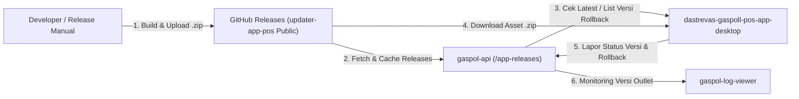

# Panduan & Arsitektur Versioning + Rollback via GitHub Releases

Dokumen ini merangkum rancangan migrasi sistem update aplikasi POS desktop (`dastrevas-gaspoll-pos-app-desktop`) dari pola manual (`version.txt` + menimpa `update.zip` di Git) ke sistem **versioning terstruktur menggunakan GitHub Releases** dengan **`gaspol-api` sebagai pusat manifest & kontrol versi**.

---

## 1. Kondisi Saat Ini vs Target Baru

| Aspek | Kondisi Saat Ini | Target Baru (GitHub Releases + `gaspol-api`) |
|---|---|---|
| **Penyimpanan File `.zip`** | Menimpa `update.zip` langsung di repo Git `updater-app-pos` | Disimpan sebagai **Release Asset** per versi di GitHub Releases (`updater-app-pos`) |
| **Daftar Versi** | Hanya 1 versi aktif di `version.txt` | Semua versi tersimpan rapi berdasarkan Git Tag (`v1.3.1.1`, `v1.3.1.2`, dst.) |
| **Sumber Rollback di Desktop** | Hanya dari backup lokal PC (`TempData\BackupApp\*.zip`) | **Hybrid**: Backup lokal **+** daftar versi lama dari `gaspol-api` (download on-demand) |
| **Kontrol & Keamanan API** | Desktop langsung tembak file statis `/server/version.txt` | Desktop & `gaspol-log-viewer` membaca manifest dari `gaspol-api` (di-cache) |
| **Repo Git `updater-app-pos`** | Membengkak karena binary `.zip` terus di-commit | Bersih dari file binary; Git hanya menyimpan script/config |

---

## 2. Arsitektur Sistem Baru



### Peran Masing-Masing Repository

1. **`updater-app-pos` (Public GitHub Repo)**
   - Menjadi rumah resmi untuk **GitHub Releases** aplikasi POS (dan opsional untuk updater helper `Dastrevas.zip`).
   - Tidak lagi melakukan `git commit` file `update.zip`.
2. **`gaspol-api` (Jantung / Release Manifest & Cache)**
   - Mengambil daftar release dari GitHub REST API (`https://api.github.com/repos/<owner>/updater-app-pos/releases`), lalu menyimpannya di cache (misal 5–10 menit) agar outlet tidak terkena rate limit GitHub.
   - Menyediakan endpoint terpusat untuk daftar versi, download URL, changelog, flag `mandatory`, dan status versi tiap outlet (`/update-confirm`).
3. **`dastrevas-gaspoll-pos-app-desktop` (POS Desktop)**
   - Mengecek update terbaru melalui `gaspol-api`.
   - Pada menu **Settings -> Rollback**, menampilkan gabungan backup lokal (`TempData\BackupApp`) dan daftar versi lama dari `gaspol-api`.
   - Memiliki mekanisme **anti-loop** setelah rollback agar aplikasi tidak langsung memaksa update kembali ke versi terbaru saat restart.
4. **`gaspol-log-viewer` (Monitoring)**
   - Menampilkan versi terbaru dari `gaspol-api` sebagai referensi dan memantau outlet mana yang masih di versi lama atau baru saja melakukan rollback.

---

## 3. SOP Rilis Manual (Alur Kerja Harian)

Karena proses build dan pengemasan `.zip` tetap dilakukan secara manual:

### Langkah 1: Siapkan Paket `.zip`
1. Build project `KASIR.csproj` dengan konfigurasi `Release` (`win-x86`).
2. Pastikan file konfigurasi lokal outlet seperti `KASIR.dll.config` **tidak ikut** dimasukkan ke dalam `.zip` (mengikuti aturan yang sudah ada di `setup.sh`), agar setting printer/outlet di PC kasir tidak tertimpa.
3. Kemas hasil build menjadi file `.zip`, disarankan dengan penamaan konsisten, misalnya:
   - `update.zip` (atau `KASIR-v1.3.1.2.zip` — pastikan aturan nama asset konsisten dengan parser di `gaspol-api`).

### Langkah 2: Buat GitHub Release di `updater-app-pos`
1. Buka repository `updater-app-pos` di GitHub -> klik **Releases** -> **Draft a new release**.
2. **Choose a tag**: buat tag baru sesuai format versi 4 digit (contoh: `v1.3.1.2`).
3. **Release title**: `v1.3.1.2`.
4. **Description / Changelog**: tulis catatan perubahan. Anda juga bisa menyisipkan tag metadata sederhana jika diperlukan `gaspol-api`, misalnya:
   ```markdown
   - Perbaikan cetak struk Bluetooth
   - Optimasi sync transaksi offline

   <!-- release-meta: {"mandatory": false, "rollback_allowed": true} -->
   ```
5. **Attach binaries**: drag & drop file `update.zip` hasil build manual.
6. Klik **Publish release**.

### Alternatif Cepat: Upload via Script `publish-release.ps1` / GitHub CLI (`gh`)

Di repo `updater-app-pos` sudah tersedia script [publish-release.ps1](file:///C:/Users/bayuf/Desktop/updater-app-pos/publish-release.ps1) untuk upload release baru dengan cepat (otomatis validasi `.zip` dan menyisipkan metadata `release-meta`):

- **Upload 1 versi baru (misal `v1.3.1.2`):**
  ```powershell
  .\publish-release.ps1 -Version 1.3.1.2 -ZipPath "C:\path\ke\update.zip" -Notes "- Perbaikan cetak struk Bluetooth"
  ```
  Tambahkan `-Mandatory` jika wajib update, atau `-NotSupportedRollback` jika versi tersebut berisiko jika dipakai rollback.

- **Atau langsung pakai `gh release create`:**
  ```powershell
  gh release create v1.3.1.2 "C:\path\ke\update.zip" `
    --repo bayufrd/updater-app-pos `
    --title "v1.3.1.2" `
    --notes-file "C:\path\ke\RELEASE_NOTES.md"
  ```
- **Upload massal arsip versi lama dari folder `Desktop\kasir-releases-archive`:**
  Semua versi `v1.2.7.0` s/d `v1.3.1.1` sudah diekstrak ke `C:\Users\bayuf\Desktop\kasir-releases-archive\vX.X.X.X\` lengkap dengan `update.zip` dan `RELEASE_NOTES.md`. Anda bisa upload bertahap lewat Web UI, atau batch via PowerShell:
  ```powershell
  Get-ChildItem "C:\Users\bayuf\Desktop\kasir-releases-archive" -Directory | Sort-Object Name | ForEach-Object {
      $tag = $_.Name
      $zip = Join-Path $_.FullName "update.zip"
      $notes = Join-Path $_.FullName "RELEASE_NOTES.md"
      gh release create $tag $zip --repo bayufrd/updater-app-pos --title $tag --notes-file $notes
  }
  ```

> [!TIP]
> - Untuk menandai versi lama yang **berisiko bentrok skema SQLite** (seperti `< 1.3.0.0`), gunakan `"rollback_allowed": false` di metadata. Di UI Desktop, versi tersebut **tetap bisa di-rollback**, tetapi akan tampil dengan **label merah `Not Supported`**.
> - Jika ingin menyembunyikan suatu versi sepenuhnya dari daftar update/rollback (misalnya ditemukan bug fatal), edit release tersebut di GitHub menjadi **Pre-release** atau **Draft**, lalu refresh cache di `gaspol-api`.

---

## 4. Rancangan Perubahan per Repository

### A. `gaspol-api`

Tambahkan controller baru (misalnya `src/controllers/appReleaseController.js`) dan daftarkan di `src/routes.js`:

- **Konfigurasi `.env`**:
  ```env
  GITHUB_RELEASES_OWNER=bayufrd
  GITHUB_RELEASES_REPO=updater-app-pos
  GITHUB_RELEASES_CACHE_TTL_MS=300000
  # Opsional: isi Personal Access Token read-only jika ingin limit API 5000 req/jam
  GITHUB_RELEASES_TOKEN=
  ```

- **Endpoint yang disediakan**:
  1. `GET /app-releases`
     Mengembalikan versi `latest` dan daftar `versions` (diurutkan dari terbaru ke terlama, draft/pre-release otomatis difilter).
  2. `GET /app-releases/latest`
     Mengembalikan hanya info versi terbaru (ringan untuk pengecekan berkala dari POS).
  3. `POST /app-releases/refresh` *(opsional)*
     Menghapus cache server secara manual tepat setelah Anda publish release baru di GitHub.

- **Contoh Response `GET /app-releases`**:
  ```json
  {
    "latest": {
      "version": "1.3.1.2",
      "tag": "v1.3.1.2",
      "download_url": "https://github.com/<owner>/updater-app-pos/releases/download/v1.3.1.2/update.zip",
      "size_bytes": 18452310,
      "published_at": "2026-11-16T15:00:00Z",
      "mandatory": false,
      "rollback_allowed": true,
      "changelog": "- Perbaikan cetak struk Bluetooth"
    },
    "versions": [
      {
        "version": "1.3.1.2",
        "tag": "v1.3.1.2",
        "download_url": "https://github.com/<owner>/updater-app-pos/releases/download/v1.3.1.2/update.zip",
        "size_bytes": 18452310,
        "published_at": "2026-11-16T15:00:00Z",
        "mandatory": false,
        "rollback_allowed": true,
        "changelog": "- Perbaikan cetak struk Bluetooth"
      },
      {
        "version": "1.3.1.1",
        "tag": "v1.3.1.1",
        "download_url": "https://github.com/<owner>/updater-app-pos/releases/download/v1.3.1.1/update.zip",
        "size_bytes": 18440120,
        "published_at": "2026-11-10T10:00:00Z",
        "mandatory": false,
        "rollback_allowed": true,
        "changelog": "- Rilis stabil sebelumnya"
      }
    ]
  }
  ```

---

### B. `dastrevas-gaspoll-pos-app-desktop`

1. **Pengecekan & Download Update (`Helper/UpdaterHelper.cs` & `Helper/UpdaterService.cs`)**
   - Ubah sumber pengecekan versi terbaru dari `/server/version.txt` menjadi `GET {BaseAddressProd}/app-releases/latest`.
   - Gunakan `download_url` dari response JSON untuk mengunduh `.zip` (baik saat pre-download silent maupun update manual), tetap pertahankan validasi `UpdaterService.IsValidUpdateZip()`.
   - Pertahankan fallback sementara ke `/server/version.txt` jika endpoint baru gagal/belum aktif selama masa transisi.

2. **Rollback Hybrid (`OffineMode/Offline_settingsForm.Bridge.cs`)**
   - `GetRollbackVersionsForWebView()` saat ini hanya membaca `TempData\BackupApp\*.zip`.
   - Ubah agar mengambil daftar versi dari `GET {BaseAddressProd}/app-releases` (yang `rollback_allowed == true` dan versinya berbeda dari versi saat ini), lalu gabungkan dengan daftar backup lokal di `TempData\BackupApp\`.
   - Tandai di UI mana yang sudah tersedia lokal (*Siap Offline*) dan mana yang perlu diunduh dulu (*Download dari Server*).
   - Saat user memilih versi dari server di `ExecuteRollbackForWebViewAsync()`, aplikasi mengunduh `download_url` ke `TempData\BackupApp\{versi}.zip`, memvalidasi zip, lalu menjalankan proses batch rollback seperti yang sudah ada.

3. **Pencegahan Auto-Update Loop setelah Rollback (`Helper/VersionManager.cs` & `Form1.cs`)**
   - Masalah: Jika kasir rollback dari `1.3.1.2` ke `1.3.1.1`, saat aplikasi menyala lagi, timer update akan melihat `latest = 1.3.1.2` dan langsung menawari/memaksa update ulang.
   - Solusi: Simpan state lokal (misalnya di `DT-Cache\rollback_pin.json` atau di `Database/settings.db`):
     ```json
     {
       "pinned_version": "1.3.1.1",
       "blocked_auto_update_version": "1.3.1.2",
       "pinned_at": "2026-11-16T22:30:00"
     }
     ```
   - Aturan:
     - Selama `latest.version == blocked_auto_update_version` (dan `mandatory == false`), **auto-update di background dilewati**.
     - Kasir tetap bisa update secara **manual** lewat tombol Update di Settings (yang sekaligus menghapus pin tersebut).
     - Jika nanti muncul versi lebih baru lagi (`1.3.1.3`), auto-update berjalan normal kembali.

---

### C. `updater-app-pos` & Masa Transisi Outlet Lama

Outlet yang saat ini masih memakai versi lama (`<= 1.3.1.1`) masih mengakses `https://gaspollmanagementcenter.com/server/version.txt` dan `/server/update.zip`.

**Strategi Transisi Aman:**
1. Untuk **1–2 rilis transisi pertama** (misal `1.3.1.2`):
   - Upload release ke **GitHub Releases**.
   - Tetap update `version.txt` dan `update.zip` di server statis agar outlet lama otomatis ter-update ke versi `1.3.1.2` (yang sudah membaca `gaspol-api`).
2. Setelah mayoritas/semua outlet terpantau di `gaspol-log-viewer` sudah berada di versi `>= 1.3.1.2`:
   - Hentikan pemakaian `update.zip` di repo Git (tambahkan `update.zip` ke `.gitignore` di `updater-app-pos`).
   - Semua rilis berikutnya cukup di-upload ke **GitHub Releases** saja.

---

### D. `gaspol-log-viewer` (Opsional / Peningkatan Monitoring)

- Panggil `GET /app-releases/latest` dari `gaspol-api` di halaman monitoring update (`LogWindowsViewer.js` / `UpdateConfirmCard.js`).
- Dengan demikian, admin bisa langsung melihat perbandingan antara versi tiap outlet dengan versi **Latest Release** resmi dari GitHub Releases, termasuk outlet yang sedang melakukan rollback.

---

## 5. Checklist Implementasi Bertahap

- [x] **Fase 1 (`updater-app-pos`)**: Upload arsip versi `v1.2.7.0` s/d `v1.3.1.1` ke GitHub Releases + sediakan script [publish-release.ps1](file:///C:/Users/bayuf/Desktop/updater-app-pos/publish-release.ps1).
- [x] **Fase 2 (`gaspol-api`)**: Implementasi `GET /app-releases`, `GET /app-releases/latest`, & `POST /app-releases/refresh` dengan in-memory cache.
- [x] **Fase 3 (`dastrevas-gaspoll-pos-app-desktop`)**:
  - [x] Integrasi cek update & download dari `gaspol-api` (dengan fallback ke `/server/version.txt` & `/server/update.zip`).
  - [x] Integrasi rollback hybrid (lokal `TempData\BackupApp` + remote download) dan redesign WebView UI di `settings.html`.
- [ ] **Fase 4 (Transisi & Verifikasi)**:
  - [ ] Uji coba update naik (`1.3.1.1` -> `1.3.1.2`) dan rollback turun (`1.3.1.2` -> `1.3.1.1`) di PC testing.
  - [ ] Pastikan laporan `/update-confirm` dan log `ROLLBACK_EXECUTE` tampil normal di `gaspol-log-viewer`.

---

## 6. Runbook Otomatis untuk AI Agent (Rilis Versi Selanjutnya)

Bagian ini adalah instruksi standar bagi **AI Agent** setiap kali user menaruh file `.zip` baru di folder `C:\Users\bayuf\Desktop\updater-app-pos\` dan meminta rilis versi selanjutnya (misalnya: *"tolong release versi selanjutnya"* atau *"upload update.zip ke release baru"*).

### Langkah Eksekusi Agent

1. **Cari & Validasi Paket `.zip`**
   - Lokasi default: `C:\Users\bayuf\Desktop\updater-app-pos\update.zip` (atau file `.zip` terbaru selain `Dastrevas.zip` jika user menaruh nama lain di folder `updater-app-pos`).
   - Pastikan isi `.zip` valid (berisi `KASIR.dll` / `KASIR.exe`) dan **tidak mengandung** `KASIR.dll.config` agar setting outlet tidak tertimpa.

2. **Tentukan Nomor Versi Berikutnya (Counting Otomatis)**
   - Ambil tag release terbaru dari GitHub:
     ```powershell
     gh release list --repo bayufrd/updater-app-pos --limit 1
     ```
     *(Bandingkan juga dengan isi `version.txt` di `updater-app-pos` sebagai referensi.)*
   - Jika user **tidak** menentukan versi khusus, naikkan versi terakhir dengan aturan **base-10 carry** (sama seperti `setup.sh`):
     - `1.3.1.1` -> `1.3.1.2`
     - `1.3.1.9` -> `1.3.2.0`
     - `1.3.9.9` -> `1.4.0.0`

3. **Susun Changelog Otomatis dari Repo Desktop**
   - Ambil tanggal rilis terakhir (`publishedAt`) dari GitHub Release terakhir:
     ```powershell
     gh release view <last_tag> --repo bayufrd/updater-app-pos --json publishedAt -q .publishedAt
     ```
   - Ambil daftar commit sejak tanggal tersebut dari repo desktop:
     ```powershell
     git -C "C:\Users\bayuf\Desktop\dastrevas-gaspoll-pos-app-desktop" log --since="<last_publishedAt>" --oneline --format="- %s (%h)"
     ```
   - Rangkum commit tersebut menjadi poin-poin changelog berbahasa Indonesia yang jelas dan rapi (tanpa jargon membingungkan), karena teks ini akan tampil langsung di **WebView Settings -> Rollback** dan **`gaspol-log-viewer`**.

4. **Jalankan Upload via `publish-release.ps1`**
   - Simpan catatan rilis ke file sementara (misal `$env:TEMP\release_notes_vX.md`) lalu jalankan dari folder `updater-app-pos`:
     ```powershell
     cd C:\Users\bayuf\Desktop\updater-app-pos
     .\publish-release.ps1 -Version <next_version> -ZipPath ".\update.zip" -NotesFile "$env:TEMP\release_notes_vX.md"
     ```
   - Tambahkan switch jika diminta user:
     - `-Mandatory` jika rilis ini wajib update.
     - `-NotSupportedRollback` jika rilis ini mengubah skema SQLite / berisiko saat rollback.
   - **Penting:** Jangan `git commit` atau `git push` file `update.zip` ke repo Git `updater-app-pos` (kecuali user secara eksplisit meminta masa transisi untuk outlet lama di `version.txt`).

5. **Refresh Cache & Verifikasi**
   - *(Opsional)* Perbarui `version.txt` lokal jika masih dalam masa transisi outlet lama.
   - Jika server `gaspol-api` sudah aktif, refresh cache manifest: `POST https://api.gaspollmanagementcenter.com/app-releases/refresh`.
   - Verifikasi release sudah live dengan `gh release view v<next_version> --repo bayufrd/updater-app-pos`, lalu laporkan **nomor versi**, **ringkasan changelog**, dan **link GitHub Release** ke user.
